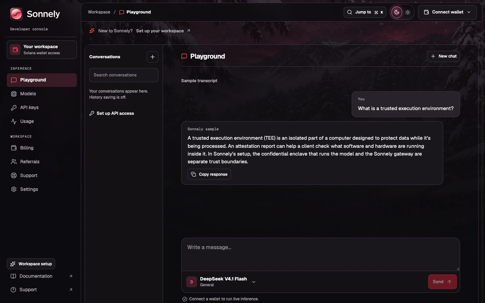
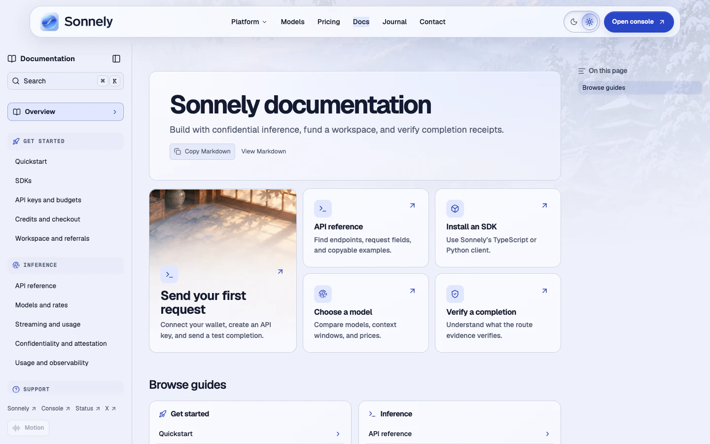

<p align="center">
  <picture>
    <source media="(prefers-color-scheme: dark)" srcset="public/brand/sonnely-crimson.svg">
    <source media="(prefers-color-scheme: light)" srcset="public/brand/sonnely-blue.svg">
    
  </picture>
</p>

<h1 align="center">Sonnely</h1>
<p align="center"><strong>Confidential AI inference on Solana</strong></p>

<p align="center">
  <a href="https://sonnely.com">Website</a> ·
  <a href="https://sonnely.com/console">Playground</a> ·
  <a href="https://docs.sonnely.com/docs/quickstart">Quickstart</a> ·
  <a href="https://sonnely.com/models">Models</a> ·
  <a href="https://sonnely.com/status">Status</a>
</p>

Sonnely is an open-source gateway for confidential model inference. Stream completions through an OpenAI-compatible API, set spending limits on API keys, and see token usage and exact charges in your workspace.

**Sonnely has no project token.** Sign in with a Solana wallet. Fund your workspace with **USDC or native SOL on Solana** through Solana Pay, and pay for inference from your credit balance. Your wallet pays Solana network fees in SOL. [Funding guide](https://docs.sonnely.com/docs/billing)

[](https://sonnely.com)

| Playground | Documentation |
| --- | --- |
| [](https://sonnely.com/console) | [](https://docs.sonnely.com/docs) |
| Try a sample without connecting a wallet. | Find SDK setup, request examples, and the API reference. |

## Send your first request

1. Open the [console](https://sonnely.com/console), connect a Solana wallet, and add credits with USDC or SOL in [Billing](https://sonnely.com/console/billing).
2. Create a key in [API keys](https://sonnely.com/console/keys). Give temporary keys a lifetime cap and expiry. Load the key into your server environment as `SONNELY_API_KEY`.
3. Discover the [live model list](https://sonnely.com/api/sonnely/v1/models) and send a completion. This example makes one billable request.

```bash
curl -fsS https://sonnely.com/api/sonnely/v1/chat/completions \
  -H "Authorization: Bearer ${SONNELY_API_KEY:?Set SONNELY_API_KEY first}" \
  -H 'Content-Type: application/json' \
  -d '{
    "model": "deepseek-ai/DeepSeek-V4.1-Flash-1017",
    "messages": [
      {"role": "user", "content": "Suggest one name for a snowy forest village."}
    ],
    "max_tokens": 128
  }'
```

Read the response in `choices[0].message.content` and verify the charge in [Usage](https://sonnely.com/console/usage). See the [streaming guide](https://docs.sonnely.com/docs/streaming), [TypeScript and Python SDKs](https://docs.sonnely.com/docs/sdks), and [OpenAPI schema](https://sonnely.com/api/openapi).

## How it works

| Layer | What it does |
| --- | --- |
| **Solana** | Wallet signatures establish workspace sessions. Finalized USDC payments fund credits. |
| **Next.js gateway** | Validates API keys and request limits, forwards prompts, and streams responses. |
| **Confidential execution** | The selected upstream model runs in a trusted execution environment. The Sonnely gateway reads prompts to validate and forward requests and operates outside that environment. [Attestation guide](https://docs.sonnely.com/docs/attestation) |
| **Convex ledger** | Reserves credits before inference, settles reported usage, and records the charge and released hold. |

For request-level evidence, send `X-Sonnely-Receipt: v1`. The optional receipt records the model, route, billing reference, upstream payload hashes, and route-specific evidence. See the [API reference](https://docs.sonnely.com/docs/api) for streaming, route selection, and request cost caps.

## Run locally

Use Node.js 26 LTS and pnpm.

```bash
git clone https://github.com/Sonnely-AI/sonnely.git
cd sonnely
pnpm install --frozen-lockfile
cp .env.example .env.local
CONVEX_AGENT_MODE=anonymous pnpm exec convex dev
```

In a second terminal, set a random high-entropy `SONNELY_SERVICE_SECRET` in the local Convex deployment and put the same value in `.env.local`. Set `CONVEX_URL` to the loopback deployment URL printed by Convex. Start Next.js with `pnpm dev` and open [localhost:3000](http://localhost:3000). Playground samples work before provider credentials are configured.

```bash
pnpm check
pnpm build
pnpm exec playwright install chromium
SONNELY_TEST_URL=http://127.0.0.1:3000 pnpm exec playwright test
```

For local admin and billing tests, add the admin and treasury addresses from [the synthetic wallet fixtures](tests/fixtures/wallets.ts) to `SONNELY_ADMIN_WALLETS` in local Convex. Set `SONNELY_TREASURY_WALLET` and `SONNELY_PROFIT_WALLET` there too. To use different fixtures, set the corresponding `SONNELY_TEST_*_WALLET` overrides in `.env.local` and match them in Convex.

## Project resources

- [Documentation source](content/docs) contains the Fumadocs MDX guides.
- [SDK source](sdk) contains the first-party TypeScript and Python clients.
- [Environment reference](.env.example) lists the server-side settings for inference, billing, and operations. Deploy the Convex functions before the web app and share the service secret between the two environments.
- [Launch operations](docs/launch-operations.md) covers production flags, payment recovery, alert delivery, invoice imports, and backups.
- [Provider notes](docs/inference-providers.md) and [Solana inference notes](docs/solana-inference-marketplace.md) describe metering and receipt evidence.

<details>
<summary>Build versioned SDK downloads</summary>

Update the package versions and download links in the SDK guide, then run these commands from the repository root.

```sh
pnpm exec tsc -p sdk/typescript/tsconfig.json
npm pack ./sdk/typescript --ignore-scripts --pack-destination public/sdk
uv build --wheel --out-dir public/sdk sdk/python
```

Rename the npm archive to `sonnely-typescript-VERSION.tgz` to match the SDK guide. Force-add the two new versioned files in `public/sdk` and retain older downloads for reproducible installs.

</details>

## License

[MIT](LICENSE) · [Support](https://sonnely.com/contact) · [Sonnely on X](https://x.com/sonnelyai)
